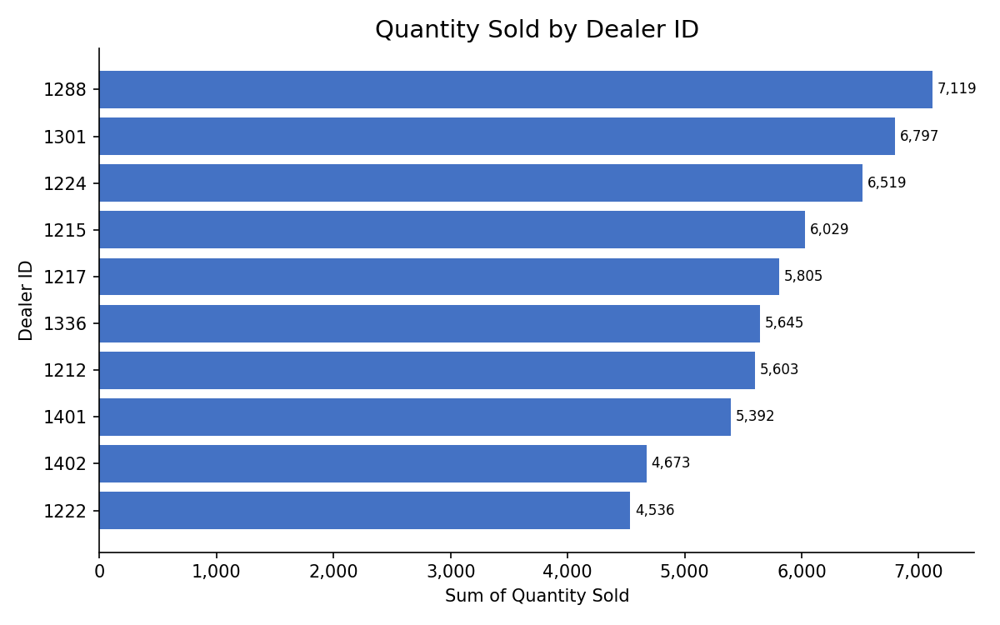
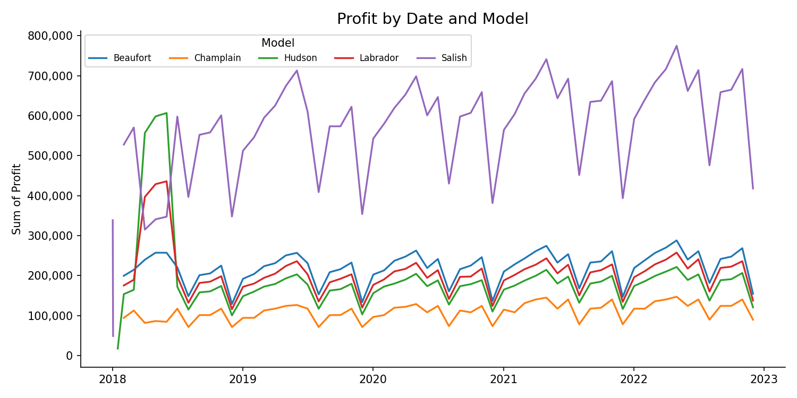
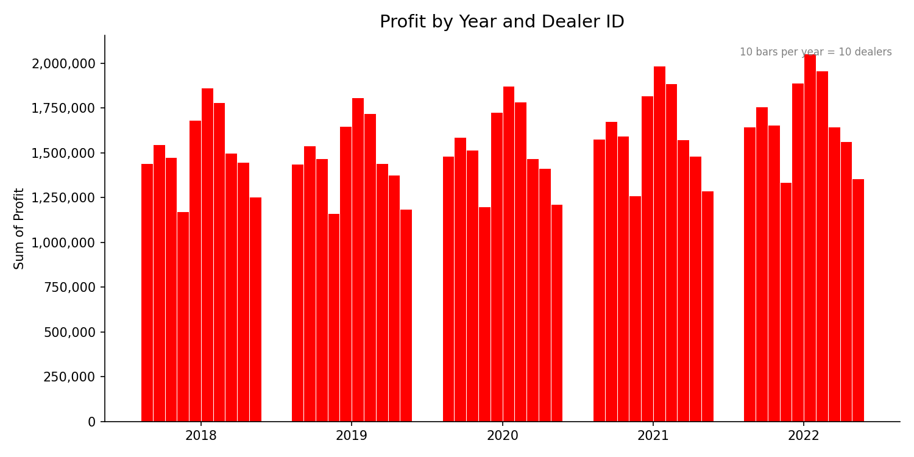
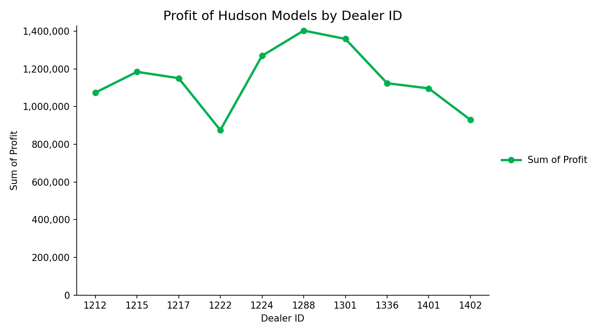

# Car Sales Excel Dashboard

An Excel analysis of automotive sales data (January 2018 - December 2022) covering
3,000 sales records across 10 dealers and 5 car models. Built with pivot tables and pivot charts.

> Completed as part of an IBM / Coursera data analytics course exercise.

## Charts

### Quantity Sold by Dealer ID

### Profit by Date and Model

### Profit by Year and Dealer ID

### Profit of Hudson Models by Dealer ID

## Key insights

- **Dealer 1288 leads on volume:** it sold the most units (7,119) and earned the highest total profit (about 9.59M). Dealer 1222 sold the fewest units (4,536).
- **Salish is the top model:** about 34.59M profit, roughly 44% of the 78.25M total. Champlain is the lowest at about 6.60M.
- **Profit grew from 2019 to 2022:** it dipped in 2019 (about 14.80M), then rose each year to about 16.87M in 2022.
- **Hudson models:** 11.47M total profit. Dealer 1288 earns the most from them (about 1.40M) and dealer 1222 the least (about 0.88M).

## What's inside

| File | Description |
|---|---|
| `CarSalesByModelEnd.xlsx` | The workbook: one pivot table and chart per tab, plus the source data on `Sheet1` |
| `*.png` | Images of the four charts |

## Tools

Microsoft Excel: pivot tables, pivot charts, sorting, filtering, chart formatting.

## Dataset

Sample automotive industry data provided in the IBM data analytics course
(columns: Year, Month, Date, Model, Dealer ID, Quantity Sold, Profit).
